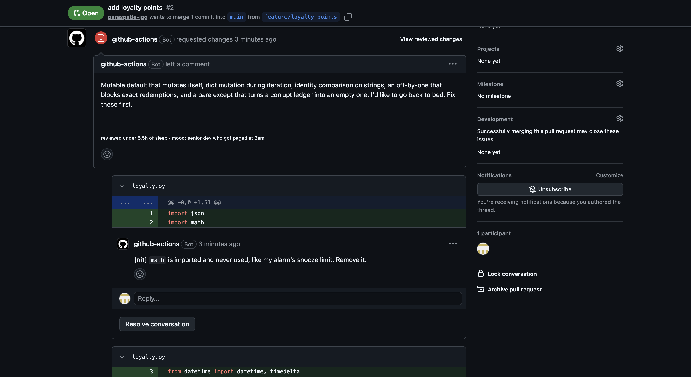
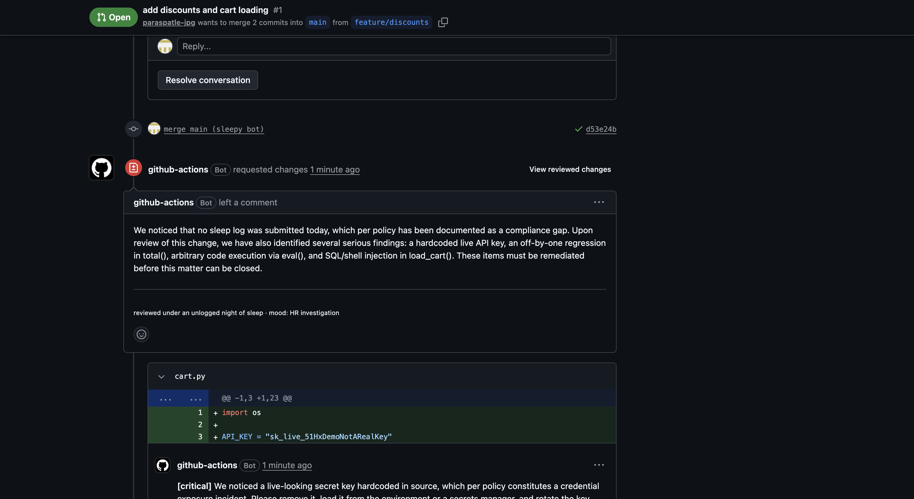

# sleep-debt 😴

**An AI code reviewer that gets meaner the less you sleep.** Your sleep debt becomes review debt.

You log how many hours you slept. When you open a PR, a GitHub bot reviews it with Claude, and your sleep decides who shows up.



> "`math` is imported and never used, like my alarm's snooze limit."
>
> "`is "gold"` only works when string interning happens to cooperate, which is about as reliable as my REM cycle."
>
> "I'd like to go back to bed. Fix these first."

[Try the demo →](https://www.paraspatle.in/projects/sleep-debt)

## Who reviews you

| Last night | Reviewer |
|---|---|
| 7.5h or more | supportive mentor |
| 6–7.5h | tech lead the day before a release |
| 5–6h | senior dev who got paged at 3am |
| under 5h | your dad looking at your marks ("Sharma ji's son writes tests") |
| didn't log | **HR investigation** |

**Committed between midnight and 4am?** The reviewer gets one level harsher. It's not personal, it's [research](https://arxiv.org/abs/1802.05084): those commits have the most bugs.

Whoever shows up, every comment has to point at a real bug or nitpick in your diff, then blame it on your sleep. The reviewer is only allowed to know what you logged, so it can't make things up about you.



## Set it up on your repo

1. **Add your Anthropic API key** as a repo secret:
   ```bash
   gh secret set ANTHROPIC_API_KEY --repo you/your-repo
   ```
2. **Add the workflow.** Copy [`examples/sleep-debt.yml`](examples/sleep-debt.yml) to `.github/workflows/` and set your timezone.
3. **Log your sleep every morning.** Clone this repo, then:
   ```bash
   python3 -m venv .venv && .venv/bin/pip install -r requirements.txt
   export SLEEPY_REPOS="you/your-repo"     # comma-separated; put this in your shell profile
   .venv/bin/python sleep.py log 5.5       # sets SLEEP_HOURS / SLEEP_DATE on each repo via `gh`
   .venv/bin/python sleep.py               # your last 7 nights
   ```

Every PR you open or push to now gets reviewed. If you forget to log, HR handles it.

The bot posts as `github-actions[bot]`, so it can actually **request changes** on your PR. Each review costs a few cents of Claude usage.

## Run it locally

From inside any repo, on the branch you want reviewed:

```bash
python /path/to/sleep-debt/review.py                    # uses today's logged sleep
python /path/to/sleep-debt/review.py --sleep 4 --hour 3 # dad mode
python /path/to/sleep-debt/review.py --pr 42            # post it on PR #42 (needs `gh`)
python /path/to/sleep-debt/review.py --dry-run          # show the mood, skip the API call
```

## How it works

- `sleep.py` keeps a local log (`sleep.json`) and pushes today's hours to your repos as GitHub variables.
- `review.py` picks a persona from your sleep and the hour of your last commit. It sends the diff to Claude (`claude-opus-5-5`) with that persona and a strict JSON schema, then posts the review with inline comments.
- The personas are a list at the top of `review.py`. To add a new reviewer, add an entry.

## Prior art

[git-sleep](https://www.rubydoc.info/gems/git-sleep/0.2.1) blocked your commits if your Jawbone said you hadn't slept enough. Jawbone shut down in 2017. This one brings it back with AI.

## License

MIT
